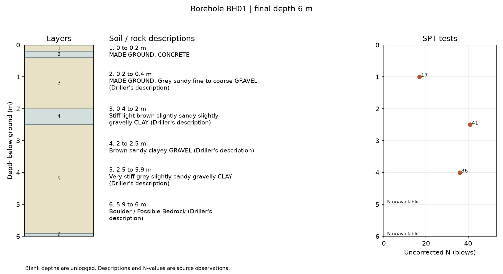

# Borehole log GIS

I built a borehole log checker because I wanted to see where public ground records were incomplete before putting them on a map. A borehole log describes the soil and rock found as a hole is drilled. My tool checks those layers for depth mistakes, shows the gaps, and makes files I can open in QGIS, a free mapping program.

I can give it a public BC borehole CSV or an AGS4 file, a common text format for exchanging ground investigation records. It produces a readable error report, layer summaries, a location map file, and a picture of each log. When penetration test results are available, it plots the recorded N-values, the number of blows measured in a Standard Penetration Test (SPT).

I also use this project to learn how ground and water calculations fit together. I can check how stable a slope is using the soil layers from a borehole log, assess recovered rock-core pieces, fit a pumping test to estimate aquifer properties, compare sewer and street flooding, check a pipe network's pressures and fire flow, and generate river profiles around a culvert. The [ground and water guide](docs/water-models.md) has exact commands, sample inputs and the limits of each calculation. These are reproducible learning examples, not a design for a real site.

To try the included public BC data with Python 3.11 or newer and [uv](https://docs.astral.sh/uv/):

```sh
git clone https://github.com/jackaI1/borehole-log-gis.git
cd borehole-log-gis
uv sync --extra dev --extra water
uv run borehole-gis samples/bc_boreholes.csv --format bc-csv --depth-unit m --out build/bc
```

Open `build/bc/issues.csv` to see the one missing depth interval. Drag `build/bc/boreholes.gpkg` into QGIS to see the four boreholes. A GeoPackage (`.gpkg`) keeps map features and their attributes in one file. Open the PNG pictures in `build/bc/logs/`; `logs.csv` matches each picture to its borehole.

## What I check

I check that layer depths increase, stay within the hole, and cover the recorded depth. Overlapping layers, invalid numbers, missing boreholes, duplicate IDs, and unsupported units stop the export. Gaps remain visible as warnings because an unlogged depth is useful information. `--strict` stops on warnings too. I never fill a gap or guess a soil type.

All exported depths are in metres. I require the input depth unit for CSV and the coordinate reference system (CRS), the grid used to locate points, for AGS. The default output grid is BC Albers (`EPSG:3005`). I use the source's own descriptions rather than automatically classifying soils. These are data checks, not a geotechnical design or a guarantee that the source record is correct.

## Try an AGS log with penetration tests

```sh
uv run borehole-gis samples/bgs_bh01.ags --format ags --crs EPSG:27700 \
  --output-crs EPSG:27700 --out build/ags
```

This public British Geological Survey excerpt has one borehole, six layers and five SPT records. Three have numerical N-values. The other two retain the source remarks and display “N unavailable”; I do not turn refusal records into invented numbers. The grid for this UK sample is British National Grid (`EPSG:27700`).



Each run needs a new or empty output folder so earlier results stay intact. Exit code `0` means the export completed; `2` means input, validation or export failed. Even when validation blocks the export, `validation.json` and `issues.csv` explain what needs attention. A completed run also writes `manifest.json`.

## Make a styled QGIS map

I included a script that uses QGIS's Python interface, PyQGIS, to save an editable project and an A4 landscape layout. It adds borehole labels, a warning legend, a scale bar, north indicator, source filename and CRS. It uses the actual GeoPackage without downloading a basemap.

On Ubuntu 24.04, install QGIS's Python package and run:

```sh
sudo apt-get update
sudo apt-get install -y --no-install-recommends python3-qgis python3-pil
QT_QPA_PLATFORM=offscreen /usr/bin/python3 scripts/qgis_map.py build/bc
```

Open `build/bc/boreholes.qgz` in QGIS, or view `map.pdf` and `map.png` in the same folder. On other systems, run the script with the Python interpreter supplied by QGIS, which has the `qgis` module available. The ordinary uv environment does not include QGIS. [Usage details](docs/usage.md) cover inputs, reports and the supported AGS fields. CI also publishes a `public-borehole-example` artifact containing both finished examples, including the QGIS projects and maps.

## Where the examples come from

The BC CSV contains 17 original intervals from four boreholes in the Province of British Columbia's [Borehole Log Lithology Public View](https://catalogue.data.gov.bc.ca/dataset/1956d690-b196-4be2-b82b-263491326a28). The published metadata describes depths in metres and coordinates in decimal degrees. I selected public log fields only. Borehole 28 has a gap from 4.9 to 5.9 m, which the tool flags.

The AGS excerpt comes from the [BGS public example collection](https://britishgeologicalsurvey.github.io/pyagsapi/#example-files). I kept BH01's observation cells and replaced the administration groups with minimal excerpt metadata. Both samples have source URLs, retrieval dates, licences and checksums in `samples/*.source.json`. BC data uses the Open Government Licence - British Columbia. The BGS sample contains data supplied by Natural Environment Research Council and public sector information licensed under the Open Government Licence v3.0. [Source notes](docs/data.md) explain the extraction and how to refresh it.

## Check a slope from the borehole layers

A slope can slide if the soil on it is too weak for the weight above it. I wanted a way to test a slope using the soil layers I already parse from a borehole, so I added `site-slope`. It takes the layers from the log, the unit weight (how heavy the soil is), the cohesion (how well the soil holds itself together) and the friction angle (how much the grains resist sliding over each other) for each soil type, and a simple cross-section of the ground. It then tries many possible curved slip surfaces and reports the lowest factor of safety. A factor of safety above 1 means the slope resists sliding; below 1 means it fails in the model.

It uses Bishop's simplified method, a standard textbook way to slice the soil above a circular slip surface and balance the forces on each slice. It also includes a water table, because water in the ground pushes the soil apart and makes sliding more likely. The tool is a free stand-in for commercial programs such as Slide and Slope/W, and it is a learning tool, not a design check.

The strength values are not in the borehole log, so I keep them in a small table, `strengths.csv`. If a soil type has no values, the tool does not guess. It marks that layer, leaves out the surfaces that pass through it, and says so in the report. Blank values stay blank.

```sh
uv run site-slope --log samples/bgs_bh01.ags --format ags --crs EPSG:27700 \
  --strengths samples/slope/strengths.csv --section samples/slope/section.json \
  --out build/slope
```

The sample uses the BGS borehole and an invented 5 m cut. Its strength values are illustrative, not measured on that site. The run finds a critical factor of safety of 1.49 and writes `report.json` with the surface's centre and radius, `surfaces.csv` with every surface tried, `critical_slices.csv` with the slices, and `section.png`, a picture of the cross-section with the critical circle and water table. The [slope notes](docs/slope-stability.md) describe the input format, the method, the output status codes and the limits.

To check the method, the tests compare the code with two published results: the infinite-slope formula, and Taylor's chart for a 45 degree slope in clay, where the stability number is about 0.181. The search gives 0.181.

## Inside the tool

I split the Python package into readers, a shared data model, depth validation, and exports. The AGS reader understands grouped quoted CSV records, including commas and line breaks inside descriptions. It checks the five required administration groups plus the location and geology groups needed for this workflow, their metadata, and declared units and types. It supports `LOCA`, `GEOL` and optional `ISPT` observations. It is a focused AGS4 reader, not a full AGS standards validator; I link the full checker and supported limits in [the usage notes](docs/usage.md).

`stratigraphy.csv` totals the thickness of each exact description per borehole. `intervals.csv` keeps individual layers and source row numbers; `spt.csv` keeps test values and remarks. The GeoPackage includes total depth, logged thickness, missing thickness, test count and warning count. Coordinate transformations use an explicit input CRS and a projected output CRS in metres.

## Tests and CI

```sh
uv run pytest -q
uv run ruff check .
uv build
```

The original 61 pytest cases cover both real samples, malformed records, missing groups and headings, units, depth conversion, overlaps, gaps, nested intervals, orphan records, SPT values and end-to-end GeoPackage and image exports. GitHub Actions runs these checks on Python 3.11, 3.12 and 3.13. The expanded suite has 108 cases including core-run checks, pumping and recovery fits, real EPANET runs and river-profile extraction. The 22 slope tests add the closed-form and Taylor chart checks, missing-strength handling, and an end-to-end run of the sample. A separate Ubuntu job installs real QGIS, renders both maps, and reopens the saved BC project to check its layer, CRS, styling, labels and layout. It also checks that the exported PDF and PNG contain output.


## Other things I've built here

- [process-hydraulics-relief-calc](projects/process-hydraulics-relief-calc/)
- [site-data-qaqc](projects/site-data-qaqc/)
- [swmm-flood-batch-runner](projects/swmm-flood-batch-runner/)
- [wind-site-screening](projects/wind-site-screening/)
