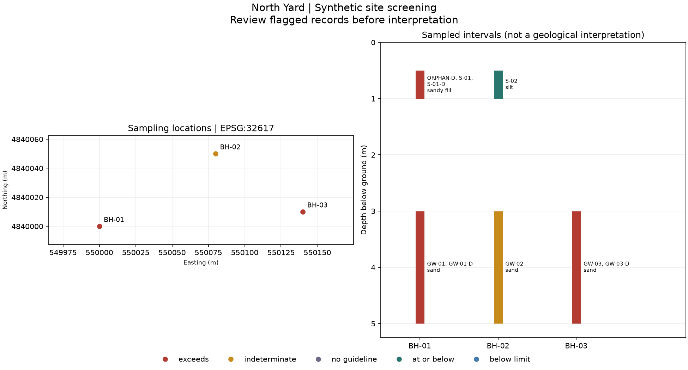

# site-data-qaqc

I built a sampling-table checker to learn how the underlying idea works. This is a learning project.

## What I look at first



The left side shows sample locations; the right shows the depths sampled in each borehole, a hole drilled to collect material or install a monitoring well. Red marks an exceedance. Yellow means the result cannot settle the comparison. Purple means I have no comparison value for that chemical. A green or blue marker still needs its other quality checks reviewed.

I start with `rejected.csv` and `issues.csv`, then look at the map. An invalid row stays in the rejection report with its original cells and a reason. I do not quietly discard it. Multiple chemicals or depths can occupy the same map location; the figure puts the most severe screening marker on top.

| Output | What I use it for |
| --- | --- |
| `site_data.sqlite` | Query the cleaned results and trace each one back to an input row |
| `standardized.csv` | Import the cleaned table elsewhere |
| `rejected.csv`, `issues.csv` | Find unusable rows and review warnings |
| `duplicates.csv` | See whether repeat measurements agree |
| `borehole_log.csv`, `sites/*.csv` | Read samples and chemical results in depth order |
| `sites/*.png` | Review one site's locations and sampled intervals together |
| `samples.gpkg`, `sample_points.geojson` | Open the sample locations in mapping software |
| `summary.json` | Check totals, input fingerprints and the rules used |

The depth reports describe sampled intervals. They do not invent geological layers between samples.

## My own input tables

I use long tables with one row per chemical measurement. The two [sample files](data/synthetic/) show different legacy headings, separators, date formats and units. The [input contract](docs/data-contract.md) lists required fields, accepted aliases and the review decisions.

```sh
uv run site-qaqc my-water.csv my-soil.csv --crs EPSG:26917 --out output/my-review
```

The coordinate reference system tells the tool how coordinates relate to the earth. EPSG:26917 means NAD83 / UTM zone 17N; it fits the synthetic southern Ontario example. I specify another system with `--crs`, or put it in each row's `crs` field. For a Windows-encoded table I add `--encoding cp1252`. Dates such as `09/10/26` are rejected rather than guessed.

## Opening the map in QGIS

QGIS is a free map viewer and editor. I export a GeoPackage, a single file containing map layers, using GeoPandas, Python's geographic table library.

1. In QGIS, drag `output/demo/samples.gpkg` onto the map and add all three layers.
2. Put `exceedances` above `sample_points`. `sample_results` has a separate feature for each chemical, so overlapping points are expected.
3. In `sample_points` Layer Properties → Symbology, choose **Categorized**, select `screening`, then **Classify**. Use red for `exceeds`, yellow for `indeterminate` and purple for `no_guideline`.
4. Open the attribute table to inspect result counts, depths and sample IDs. For individual concentrations, use `sample_results`; its `record_id` joins to the database audit record.

All exported layers declare WGS84 longitude/latitude (EPSG:4326). The figures use local UTM coordinates in metres and work without an online basemap. I test that the written GIS files can be reopened with their geometry, attributes and coordinate system intact.

## Rules I chose

I convert water results to mg/L and dry-soil results to mg/kg. I preserve a non-detect such as `<2 ug/L` as a missing concentration with a `0.002 mg/L` upper bound. It never becomes zero. If that bound exceeds the guideline, the result is uncertain rather than clean. Unsupported units, unknown laboratory qualifiers, missing required fields, wet soil and invalid depth intervals are rejected.

For repeat samples I calculate relative percent difference, the size of the disagreement relative to the pair's average. The example pair of 0.018 and 0.030 mg/L differs by **50%**, exceeding my default **30%** limit. I only calculate this check when both measurements are detected and each is above five times its own detection limit. Near-limit or missing-parent pairs get a reason instead of a misleading pass. Both policy settings can be changed:

```sh
uv run site-qaqc data/synthetic/*.csv --rpd-limit 25 --dl-multiplier 5 --out output/tighter-review
sqlite3 output/demo/site_data.sqlite "SELECT site_id, sample_id, analyte, value, unit FROM exceedances;"
```

I bundle only three sourced values: groundwater arsenic and benzene, and soil arsenic. Other chemicals stay visible as `no_guideline`. The soil comparison assumes residential/parkland use and a dry-weight result. Real site work needs a review of the applicable standards, laboratory methods and sampling plan. This version holds the tables in memory and draws compact figures for a handful of boreholes per site.

## Tests and limits

There are 4 test source files in this copy. No test pass count is claimed here: I have not re-run the project suite as part of this move. This is a source snapshot, and running it on a new machine may need environment-specific setup.


Project checks run from this directory through the path-filtered hub workflows: (removed workflow).

The relocated workflow failed in GitHub Actions and was removed to keep the hub checks independent. Local test sources remain available.
